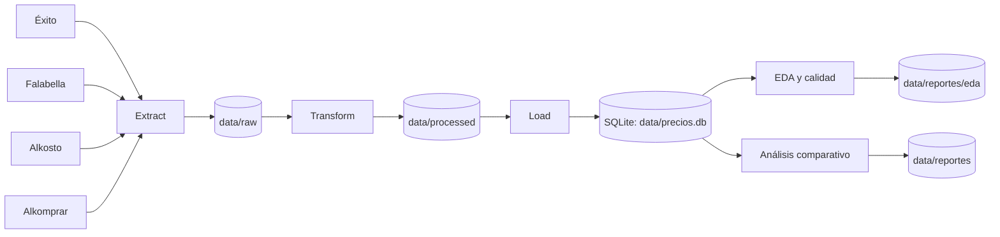
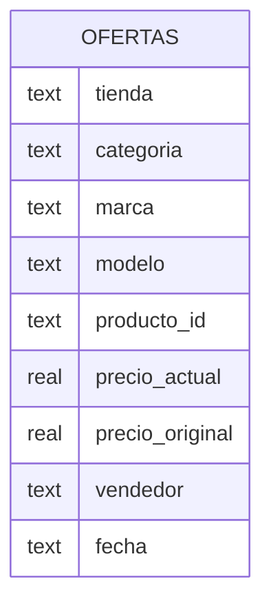
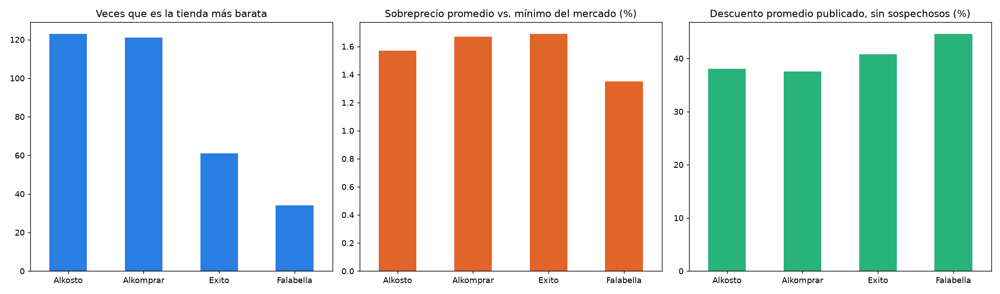
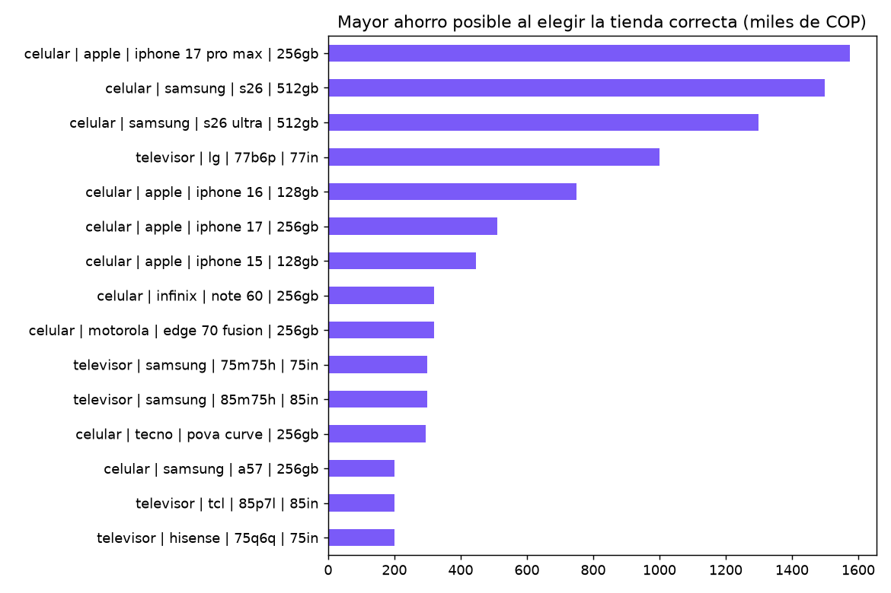
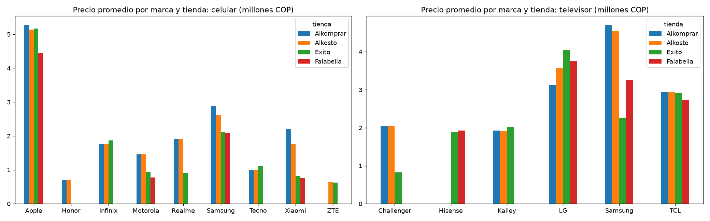

# Comparador de precios retail en Colombia

> Pipeline ETL en Python que extrae ofertas públicas de celulares y televisores desde Éxito, Falabella, Alkosto y Alkomprar, limpia y homologa productos equivalentes, almacena un histórico en SQLite y genera análisis comparativos de precios y ahorro potencial.

**Curso:** ETL — Maestría en Inteligencia Artificial y Ciencia de Datos, Universidad Autónoma de Occidente  
**Periodo:** 2026-2  
**Docente:** Fernando Barraza Alvarado  

## Integrantes

| Nombre | Código | Correo institucional | Usuario de GitHub |
|---|---:|---|---|
| Andres Felipe Pacheco | 1061771208 | andres_fel.pacheco@uao.edu.co | [@AndresF1994](https://github.com/AndresF1994) |

## Tabla de contenido

1. [Descripción del problema](#1-descripción-del-problema)
2. [Fuentes de datos](#2-fuentes-de-datos)
3. [Arquitectura del pipeline](#3-arquitectura-del-pipeline)
4. [Estructura del repositorio](#4-estructura-del-repositorio)
5. [Requisitos](#5-requisitos)
6. [Instalación y configuración](#6-instalación-y-configuración)
7. [Ejecución](#7-ejecución)
8. [Detalle de las etapas ETL](#8-detalle-de-las-etapas-etl)
9. [Modelo y diccionario de datos](#9-modelo-y-diccionario-de-datos)
10. [Calidad de datos y validaciones](#10-calidad-de-datos-y-validaciones)
11. [Resultados](#11-resultados)
12. [Limitaciones y trabajo futuro](#12-limitaciones-y-trabajo-futuro)
13. [Referencias](#13-referencias)

## 1. Descripción del problema

Los precios de productos tecnológicos pueden variar entre comercios, vendedores y momentos de consulta. Además, las tiendas publican sus catálogos con estructuras, nombres, identificadores y atributos diferentes, lo que dificulta comparar automáticamente el mismo producto. Un mismo celular o televisor puede aparecer con distintas convenciones de nombre, colores, capacidades, códigos de modelo, vendedores de marketplace, combos o condiciones comerciales.

El proyecto construye un pipeline ETL reproducible para recolectar ofertas públicas de cuatro comercios colombianos, normalizar los atributos relevantes, homologar productos equivalentes y conservar un histórico de precios. El conjunto resultante permite realizar análisis comparativos orientados al consumidor y evaluar diferencias de precio entre tiendas para un mismo producto.

**Objetivo:** disponer de una base histórica consolidada de ofertas de celulares y televisores que permita identificar productos equivalentes entre tiendas, comparar precios, estimar ahorro potencial y generar reportes analíticos reproducibles.

## 2. Fuentes de datos

La extracción se realiza sobre información pública visible en los listados de búsqueda de cada comercio. La corrida completa usada para los resultados finales del proyecto obtuvo 2.029 registros crudos.

| Fuente | Tipo | Origen / URL | Tamaño aprox. en la corrida final | Frecuencia de actualización | Licencia / condiciones |
|---|---|---|---:|---|---|
| Éxito | Web | https://www.exito.com/ | 273 registros crudos | Fuente dinámica; consulta diaria configurable | No se declara licencia abierta; uso académico sujeto a términos del sitio y `robots.txt` |
| Falabella | Web | https://www.falabella.com.co/ | 891 registros crudos | Fuente dinámica; consulta diaria configurable | No se declara licencia abierta; uso académico sujeto a términos del sitio y `robots.txt` |
| Alkosto | Web | https://www.alkosto.com/ | 450 registros crudos | Fuente dinámica; consulta diaria configurable | No se declara licencia abierta; uso académico sujeto a términos del sitio y `robots.txt` |
| Alkomprar | Web | https://www.alkomprar.com/ | 415 registros crudos | Fuente dinámica; consulta diaria configurable | No se declara licencia abierta; uso académico sujeto a términos del sitio y `robots.txt` |

El alcance actual incluye dos categorías:

- **Celulares:** Samsung, Apple/iPhone, Xiaomi, Motorola, Honor, Infinix, Tecno, Oppo, Realme y ZTE.
- **Televisores:** Samsung, LG, TCL, Hisense, Kalley, Challenger, Sony y Xiaomi.

## 3. Arquitectura del pipeline



La extracción utiliza Playwright para cargar las páginas dinámicas y luego procesa el HTML o los datos estructurados disponibles según la fuente. Los datos crudos se conservan separados de las transformaciones. La etapa Transform normaliza atributos y construye una clave común de producto. Finalmente, Load almacena las ofertas homologadas en SQLite, elección adecuada por su portabilidad, reproducibilidad y ausencia de dependencia de un servidor externo.

**Tecnologías:** Python 3.12, pandas, Playwright, BeautifulSoup4, SQLite, matplotlib, openpyxl y pytest.

## 4. Estructura del repositorio

```text
.
├── data/
│   ├── raw/                    # Extracciones originales por fecha (ignorado por Git)
│   ├── processed/              # Datos transformados intermedios (ignorado por Git)
│   ├── precios.db              # Base histórica SQLite
│   └── reportes/
│       ├── eda/                # Tablas, métricas y figuras del EDA
│       ├── precio_por_marca.png
│       ├── reporte_precios.xlsx
│       ├── resumen_tiendas.png
│       └── top_ahorro.png
├── docs/
│   └── entrega_2/              # Evidencias y documentación de la Entrega 2
├── src/
│   ├── extract/                # Extractores por tienda
│   ├── transform/              # Limpieza, atributos y homologación
│   ├── load/                   # Persistencia en SQLite
│   ├── analisis.py             # Comparación de precios y ahorro
│   ├── config.py               # Parámetros del proyecto
│   ├── eda.py                  # EDA y calidad de datos
│   ├── informe.py              # Generación del informe de la Entrega 2
│   └── pipeline.py             # Orquestación Extract → Transform → Load
├── tests/
│   ├── fixtures/               # HTML de prueba para extractores
│   ├── test_atributos.py
│   └── test_extract.py
├── .gitignore
├── CONTEXTO_PROYECTO.md
├── requirements.txt
├── run_diario.bat
└── README.md
```

## 5. Requisitos

- Python **3.12** recomendado.
- `pip` y `venv`.
- Chromium instalado mediante Playwright.
- Dependencias listadas en `requirements.txt`.
- Conexión a Internet para ejecutar la etapa de extracción.
- Entorno probado en Ubuntu 24.04 bajo WSL2. También puede ejecutarse en Windows con un entorno de Python compatible.

Dependencias principales:

```text
playwright>=1.45
beautifulsoup4>=4.12
pandas>=2.2
matplotlib>=3.9
openpyxl>=3.1
pytest>=8.0
```

## 6. Instalación y configuración

```bash
# 1. Clonar el repositorio
git clone https://github.com/AndresF1994/etl-comparador-precios-retail-colombia.git
cd etl-comparador-precios-retail-colombia

# 2. Crear el entorno virtual
python3 -m venv .venv

# Linux / WSL
source .venv/bin/activate

# Windows PowerShell
# .venv\Scripts\Activate.ps1

# 3. Actualizar pip e instalar dependencias
python -m pip install --upgrade pip
python -m pip install -r requirements.txt

# 4. Instalar Chromium para Playwright
python -m playwright install --with-deps chromium
```

En Windows nativo puede utilizarse:

```bash
python -m playwright install chromium
```

### Variables de entorno

La versión actual del proyecto **no requiere credenciales ni variables de entorno**. La base de datos se almacena localmente en SQLite (`data/precios.db`) y la extracción utiliza únicamente información pública de los sitios consultados.

El archivo `.gitignore` excluye `.env` y `*.env` como medida preventiva para evitar publicar credenciales si en el futuro se incorporan servicios externos.

### Obtención de los datos

Los datos crudos no se versionan en GitHub. La etapa Extract los obtiene automáticamente desde las cuatro fuentes:

```bash
python -m src.pipeline
```

Cada corrida genera un archivo crudo por fecha dentro de `data/raw/`. La extracción completa puede tardar aproximadamente 30 minutos, dependiendo de la conexión, respuesta de los sitios y disponibilidad de sus páginas.

## 7. Ejecución

### Pipeline completo

```bash
python -m src.pipeline
```

### Ejecuciones parciales

```bash
# Solo una categoría, marca y tienda
python -m src.pipeline \
  --categorias celular \
  --marcas Samsung \
  --tiendas Exito

# Ejemplo por categoría y marca
python -m src.pipeline \
  --categorias televisor \
  --marcas LG
```

### Reprocesar datos crudos existentes

```bash
python -m src.pipeline --solo-transformar --fecha 2026-09-28
```

### EDA y calidad

```bash
python -m src.eda
```

Salida principal:

```text
data/reportes/eda/
```

### Análisis comparativo

```bash
python -m src.analisis
```

También puede filtrarse por categoría:

```bash
python -m src.analisis --categoria televisor
```

Salida principal:

```text
data/reportes/
```

### Pruebas automatizadas

```bash
python -m pytest -q
```

Estado validado para la entrega:

```text
43 passed
```

### Programación diaria en Windows

El archivo `run_diario.bat` permite automatizar la ejecución y guardar logs en `data/logs/`.

Ejemplo con el Programador de tareas:

```bat
schtasks /create /tn "ComparadorPrecios" /tr "\"%CD%\run_diario.bat\"" /sc daily /st 07:00
```

**Salida esperada:** archivo RAW por fecha, datos transformados, actualización de `data/precios.db`, métricas del EDA, gráficos y un archivo Excel con el análisis comparativo.

## 8. Detalle de las etapas ETL

### 8.1 Extract

- **Qué hace:** ejecuta búsquedas por categoría y marca en cada una de las cuatro tiendas, carga las páginas dinámicas mediante Playwright y extrae nombre, URL, precios, vendedor, EAN cuando está disponible y otros atributos visibles.
- **Scripts:** `src/extract/`
- **Salida:** `data/raw/ofertas_raw_AAAA-MM-DD.csv`

La estrategia de parseo depende de la estructura de cada sitio. Se utilizan HTML procesado con BeautifulSoup y, cuando está disponible, información estructurada embebida en la página.

### 8.2 Transform

- **Qué hace:** limpia, valida, deduplica y homologa productos para permitir comparaciones entre fuentes.
- **Scripts:** `src/transform/`
- **Salida:** `data/processed/` y estructuras utilizadas por Load.

| # | Transformación | Justificación |
|---:|---|---|
| 1 | Normalización de texto y marcas | Los sitios utilizan mayúsculas, separadores y convenciones diferentes |
| 2 | Eliminación de duplicados | Algunas búsquedas devuelven la misma publicación más de una vez |
| 3 | Validación de categoría y rango de precios | Reduce accesorios y resultados fuera del alcance |
| 4 | Extracción de marca y modelo | Permite crear una identidad común entre fuentes |
| 5 | Extracción de almacenamiento y RAM en celulares | Distingue variantes técnicamente diferentes |
| 6 | Extracción de pulgadas y código de modelo en televisores | Evita comparar tamaños o referencias distintas |
| 7 | Identificación de combos | Un producto individual no debe compararse directamente con un paquete |
| 8 | Identificación de condición | Permite separar productos nuevos y reacondicionados |
| 9 | Clasificación de vendedor propio / marketplace | Distingue la tienda que publica del vendedor real |
| 10 | Cálculo y control de descuentos | Detecta porcentajes atípicos sin eliminar automáticamente la oferta |
| 11 | Consolidación de variantes de color | El color no cambia la identidad principal del producto comparado |
| 12 | Construcción de `producto_id` | Genera la llave semántica utilizada para homologar entre tiendas |

La clave de homologación sigue estas reglas principales:

```text
Celular:
categoria | marca | modelo | almacenamiento

Televisor:
categoria | marca | modelo | pulgadas
```

Ejemplos:

```text
celular | samsung | s26 | 512gb
televisor | samsung | 75m75h | 75in
```

### 8.3 Load

- **Qué hace:** carga las ofertas transformadas e identificadas en una base SQLite.
- **Script:** `src/load/db.py`
- **Destino:** `data/precios.db`
- **Tabla principal:** `ofertas`
- **Modo:** histórico por fecha con comportamiento idempotente para una misma fecha de ejecución.

SQLite fue seleccionado por ser portable, liviano, reproducible y suficiente para el volumen académico manejado por el proyecto.

## 9. Modelo y diccionario de datos

El modelo actual utiliza una tabla analítica principal:

```text
ofertas
```

Relación conceptual:



### Tabla `ofertas`

| Columna | Tipo lógico | Descripción | Ejemplo |
|---|---|---|---|
| `tienda` | texto | Comercio donde se obtuvo la oferta | `Alkosto` |
| `busqueda` | texto | Término utilizado durante Extract | `Samsung` |
| `nombre` | texto | Nombre original publicado | `Celular SAMSUNG Galaxy S26...` |
| `marca_tienda` | texto / nulo | Marca informada explícitamente por la fuente | `SAMSUNG` |
| `url` | texto | URL pública del producto | `https://...` |
| `ean` | texto / nulo | Identificador EAN cuando está disponible | `880609...` |
| `precio_original` | numérico | Precio de referencia antes del descuento | `5299990` |
| `precio_actual` | numérico | Precio observado en la corrida | `3799900` |
| `vendedor` | texto | Vendedor informado en la publicación | `Falabella` |
| `categoria` | texto | Categoría normalizada | `celular` |
| `marca` | texto | Marca normalizada | `samsung` |
| `modelo` | texto | Modelo normalizado | `s26` |
| `almacenamiento_gb` | entero / nulo | Capacidad de almacenamiento del celular | `512` |
| `ram_gb` | entero / nulo | Memoria RAM cuando se identifica | `12` |
| `pulgadas` | numérico / nulo | Tamaño del televisor | `75` |
| `combo` | booleano | Indica si la oferta incluye productos adicionales | `0` |
| `variante` | texto | Variante técnica utilizada en homologación | `512gb` |
| `condicion` | texto | Estado comercial identificado | `nuevo` |
| `tipo_vendedor` | texto | Vendedor propio o marketplace | `propio` |
| `descuento_pct` | numérico | Descuento calculado | `28.3` |
| `descuento_sospechoso` | booleano | Marca descuentos que requieren revisión | `0` |
| `descuento_pct_valido` | numérico / nulo | Descuento aceptado para análisis | `28.3` |
| `producto_id` | texto | Clave semántica común entre tiendas | `celular | samsung | s26 | 512gb` |
| `fecha` | fecha | Fecha de observación del precio | `2026-10-10` |

## 10. Calidad de datos y validaciones

La corrida completa utilizada como evidencia final produjo el siguiente embudo:

| Verificación | Antes | Después / resultado |
|---|---:|---:|
| Registros extraídos | 2.029 | 2.029 RAW |
| Registros que superan validaciones iniciales | 2.029 | 1.557 |
| Registros homologables | 1.557 | 1.214 |
| Registros después de consolidar variantes de color | 1.214 | 809 |
| Ofertas sin modelo/variante identificable | 343 | Excluidas de la comparación |
| Productos almacenados sin `producto_id` | — | 0 en la carga final |
| Precios nulos o no positivos en la carga final | — | 0 |
| Pruebas automatizadas | 43 | 43 aprobadas |

Principales controles implementados:

- deduplicación de publicaciones;
- normalización de texto;
- validación de categoría;
- validación de precios;
- extracción de atributos técnicos;
- detección de combos;
- identificación de reacondicionados;
- clasificación marketplace / vendedor propio;
- detección de descuentos sospechosos;
- homologación por `producto_id`;
- consolidación de variantes de color.

La disponibilidad de atributos no es uniforme. Alkosto y Alkomprar proporcionan EAN en una proporción alta, mientras que Éxito y Falabella pueden no entregarlo en los listados analizados. Por esta razón, el pipeline no depende exclusivamente del EAN para homologar.

## 11. Resultados

La ejecución final cargó **809 ofertas homologadas** en SQLite y permitió identificar **172 productos comparables entre las cuatro tiendas**, es decir, productos disponibles en al menos dos comercios dentro del universo analizado.

Entre los resultados destacados:

- **iPhone 17 Pro Max 256 GB:** diferencia observada de hasta **$1.575.400 COP** entre el precio mínimo y máximo.
- **Samsung Galaxy S26 512 GB:** diferencia observada de **$1.500.090 COP**.
- **Samsung Galaxy S26 Ultra 512 GB:** diferencia observada de **$1.300.090 COP**.
- **LG 77B6P de 77 pulgadas:** diferencia observada de **$1.000.000 COP**.
- En el EDA normalizado, **19 productos** estuvieron presentes simultáneamente en las cuatro tiendas.

Consulta SQL de ejemplo:

```sql
SELECT
    tienda,
    categoria,
    COUNT(*) AS ofertas,
    ROUND(AVG(precio_actual), 0) AS precio_promedio
FROM ofertas
WHERE fecha = '2026-10-10'
GROUP BY tienda, categoria
ORDER BY tienda, categoria;
```

Consulta para localizar productos presentes en varias tiendas:

```sql
SELECT
    producto_id,
    COUNT(DISTINCT tienda) AS numero_tiendas,
    MIN(precio_actual) AS precio_minimo,
    MAX(precio_actual) AS precio_maximo,
    MAX(precio_actual) - MIN(precio_actual) AS ahorro_potencial
FROM ofertas
WHERE fecha = '2026-10-10'
GROUP BY producto_id
HAVING COUNT(DISTINCT tienda) >= 2
ORDER BY ahorro_potencial DESC;
```

### Evidencias analíticas

#### Resumen por tienda

<p align="center">
  
</p>

La figura resume, para cada tienda, la frecuencia con la que aparece como opción de menor precio, el sobreprecio promedio frente al mínimo observado y el descuento promedio publicado después de excluir descuentos sospechosos.

#### Productos con mayor ahorro potencial

<p align="center">
  
</p>

La figura muestra los productos con mayor diferencia entre el precio mínimo y el máximo observados entre las tiendas comparables, expresada en miles de pesos colombianos.

#### Precio promedio por marca y tienda

<p align="center">
  
</p>

La figura compara el precio promedio por marca y tienda para las categorías de celulares y televisores. Esta visualización debe interpretarse como una caracterización del catálogo y no como una comparación directa de tiendas, ya que la composición de productos puede variar entre ellas.

El archivo detallado con la comparación se encuentra en:

```text
data/reportes/reporte_precios.xlsx
```

El EDA genera adicionalmente métricas, tablas y seis figuras en:

```text
data/reportes/eda/
```

## 12. Limitaciones y trabajo futuro

- Los sitios de comercio electrónico son dinámicos; cambios en HTML, JavaScript o selectores pueden requerir mantenimiento de los extractores.
- La información publicada por las fuentes no es homogénea. En particular, el EAN no está disponible en todas las tiendas.
- La homologación semántica puede producir falsos positivos o falsos negativos cuando los nombres comerciales son ambiguos.
- Marketplace, combos, accesorios y productos reacondicionados requieren controles adicionales para asegurar comparaciones equivalentes.
- Los precios pueden depender de promociones, medios de pago, ubicación, inventario o condiciones comerciales no completamente observables desde el listado.
- El histórico disponible todavía es limitado para realizar análisis robustos de series temporales.
- Algunas corridas parciales utilizadas durante desarrollo no deben interpretarse como fotografías completas del mercado.
- Como trabajo futuro se propone fortalecer el matching con similitud semántica, crear índices en SQLite, ampliar el histórico, incorporar alertas de cambio de precio y automatizar la ejecución mediante un scheduler o servicio en la nube.
- También puede incorporarse una capa de visualización interactiva o API de consulta sobre la base histórica.

## 13. Referencias

- Éxito. https://www.exito.com/
- Falabella Colombia. https://www.falabella.com.co/
- Alkosto. https://www.alkosto.com/
- Alkomprar. https://www.alkomprar.com/
- Playwright for Python. https://playwright.dev/python/
- pandas documentation. https://pandas.pydata.org/docs/
- Beautiful Soup documentation. https://www.crummy.com/software/BeautifulSoup/bs4/doc/
- SQLite documentation. https://www.sqlite.org/docs.html
- matplotlib documentation. https://matplotlib.org/stable/
- pytest documentation. https://docs.pytest.org/

### Uso de IA generativa

Se utilizó **ChatGPT de OpenAI** como herramienta de apoyo para revisión de código, análisis metodológico, depuración del entorno de ejecución, revisión de resultados y estructuración de documentación. Las decisiones finales, ejecución del pipeline, pruebas automatizadas y validación de resultados fueron realizadas sobre el código y los datos del proyecto.

---

**Repositorio:** [AndresF1994/etl-comparador-precios-retail-colombia](https://github.com/AndresF1994/etl-comparador-precios-retail-colombia)
